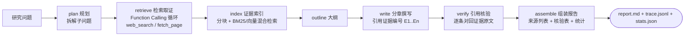

# DeepScout · 深度调研 Agent

[](https://github.com/yangyumengovo/DeepScout/actions/workflows/ci.yml)
[](https://www.python.org/)
[](LICENSE)

> 输入一个研究问题，Agent 自主完成：**子问题规划 → 多源检索与网页取证（Function Calling）→ 证据库构建与混合检索（RAG）→ 分章撰写带引用的报告 → 逐条引用核验**，全程 trace 可归因、成本可统计。

<!-- TODO: 录制真实模式演示 GIF 后替换此处（强烈建议，转化率差别很大）
 -->

## 为什么做这个项目

开源深度调研 Agent（gpt-researcher、LangChain deepagents 等）解决了「能不能自动调研」，但我在学习和复现过程中发现了三个可以做得更认真的地方：

1. **引用不可信的调研报告没有价值。** 多数工具生成的报告带引用编号，但从不校验「编号指向的证据是否真的支撑那句话」。DeepScout 增加独立的 **verify 节点**，把每条引用对回证据原文逐条核验，在报告末尾给出 supported / partial / unsupported 明细表与通过率。
2. **Agent 的可靠性要从评测和归因来，不能靠感觉。** 每次运行的 LLM 调用、工具调用、节点耗时全部记入 `trace.jsonl`，配套评测脚本输出关键词覆盖 / 引用核验率 / 成本 / 延迟指标——报告错了能定位是检索没查到、工具失败还是模型幻觉。
3. **LLM 应用的工程下限要和普通后端一样高。** 单元测试不依赖真实模型（FakeLLM 确定性回放 + mock 搜索 + 内置演示语料），CI 无 API key 全绿；支持 Docker 一键部署、SSE 流式接口、供应商可切换（换模型只改环境变量）。

## 架构



编排基于 **LangGraph**（LangChain 官方图编排框架）：每个节点职责单一、可独立测试，状态显式流动。其中 `retrieve` 节点内部是一个真正的工具调用循环——模型自主决定抓取哪些页面、是否换关键词重搜，工具结果回填后继续推理，带最大步数保护。

## 快速开始

### 30 秒离线体验（无需 API key、无需网络）

```bash
git clone https://github.com/yangyumengovo/DeepScout.git
cd DeepScout
pip install -e .
deepscout research "大模型长上下文技术如何扩展？" --mock
```

离线模式使用确定性 FakeLLM + 内置演示语料，完整走一遍上述七个节点（含真实 Function Calling 路径），用于演示与回归测试。**真实调研效果请配置 API key 后运行。**

### 真实调研

```bash
cp .env.example .env          # 填入任意 OpenAI 兼容服务的 key（DeepSeek/GLM/Qwen 均可）
deepscout research "2026 年国产大模型的竞争格局如何？"
```

产物保存在 `runs/<run_id>/`：`report.md`（报告）、`sources.json`（来源）、`stats.json`（指标）、`trace.jsonl`（全程追踪）。

### API 服务（SSE 流式进度）

```bash
docker compose up --build     # 或： uvicorn deepscout.api.app:app --port 8000
curl -X POST localhost:8000/api/research -H "Content-Type: application/json" \
     -d '{"question": "MCP 协议解决了什么问题？"}'
curl -N localhost:8000/api/research/<run_id>/stream    # 实时节点进度 + 最终报告
```

接口文档（Swagger UI）：`http://localhost:8000/docs`

### Web UI

```bash
pip install -e ".[ui]"
deepscout ui            # 打开 http://127.0.0.1:7860
```

## 配置

| 环境变量 | 默认值 | 说明 |
|---|---|---|
| `DEEPSCOUT_LLM_API_KEY` | — | LLM API key（必填，mock 模式除外） |
| `DEEPSCOUT_LLM_BASE_URL` | DeepSeek | 任意 OpenAI 兼容服务（GLM / Qwen / 本地 vLLM） |
| `DEEPSCOUT_LLM_MODEL` | `deepseek-chat` | 模型名，换供应商只改这两项 |
| `DEEPSCOUT_SEARCH_PROVIDER` | `ddgs` | 搜索源：`ddgs`（免 key）/ `tavily` / `mock` |
| `DEEPSCOUT_EMBED_PROVIDER` | `none` | `fastembed` 开启 bge-small-zh 向量 + BM25 混合检索 |
| `DEEPSCOUT_RERANK_PROVIDER` | `none` | `fastembed` 开启 bge-reranker-v2-m3 重排（需 `.[rerank]` 可选依赖） |
| `DEEPSCOUT_MAX_SUBQUERIES` | `3` | 子问题拆解数量 |

完整参数见 [.env.example](.env.example)。LLM 响应默认带磁盘缓存（`.cache/`），开发期重复调试不重复计费。

## 评测

```bash
python eval/run_eval.py --mock               # 离线冒烟（CI 同款，验证流水线而非质量）
python eval/run_eval.py --type boundary      # 拒答边界题（防幻觉）
python eval/run_eval.py --ablate --limit 3   # 消融：full/no-plan/no-verify/naive 四配置对比
```

指标：**关键词覆盖率**（预期要点命中）、**拒答命中率**（边界题如实声明信息不足）、**引用核验通过率**（verify 节点）、**唯一来源数**（多样性）、token / 延迟（工程指标）。评测集 30 题，分事实 / 综合 / 拒答边界三层（[eval/questions.json](eval/questions.json)），历史报告存于 `eval/report_*.md`。

### 真实结果（GLM-4-Flash，2026-10-16）

**边界题迭代**（2 道虚构对象题，v1 → v1.2 prompt 约束 → v1.3 硬校验）：

| 指标 | v1 | v1.2 | v1.3 |
|---|---|---|---|
| 拒答命中率 | 0% | 100% | **100%** |
| 虚构论文题核验通过率 | 14% | 56% | **62.5%** |

v1.3 的「对象锚点硬校验」：从题目提取对象锚点（产品名/论文标题等），仅允许引用文本中实际包含锚点的证据——从机制上阻断「主题相邻」式幻觉。已知局限：单词锚点可能碰撞（某工具清单页恰好含 "ResearchBot" 字样），此时 verify 节点作为最后一道防线将引用如实判为不支撑（该次运行核验率 0%，即碰撞被完整暴露）。详见 [docs/design.md](docs/design.md) 第 8 节。

**消融实验一：简单事实题**（3 题 × 4 配置，均值）：

| 配置 | 关键词覆盖 | 核验通过率 | 唯一来源数 | token | 用时s |
|---|---|---|---|---|---|
| full | 0.778 | 0.767 | 2.33 | 31624 | 140.0 |
| no-plan | **0.889** | **1.0** | 1.67 | 23289 | 105.3 |
| no-verify | 0.778 | - | **3.0** | 37112 | 156.0 |
| naive | **0.889** | - | 2.0 | **21962** | 62.8* |

**消融实验二：宽泛综合题**（3 题 × 4 配置，均值）：

| 配置 | 关键词覆盖 | 唯一来源数 | token |
|---|---|---|---|
| full | **1.0** | **4.0** | 37342 |
| no-plan | 0.778 | 2.0 | 20328 |
| naive | 0.889 | 2.0 | 18751 |

\* 个别 naive 运行的秒数为磁盘缓存命中（与 no-plan 消息序列相同），其余为真实耗时。

**消融实验三：Rerank 重排**（同 3 道事实题，与 full 仅差 rerank 一个变量）：

| 配置 | 关键词覆盖 | 核验通过率 | 用时s |
|---|---|---|---|
| full | 0.778 | 0.767 | 140.0 |
| full+rerank | **0.889** | **0.958** | 209.7 |

重排（bge-reranker-v2-m3 cross-encoder）把「词面命中但语义跑偏」的证据块挤出前 6，核验通过率 +19pp、覆盖 +11pp；代价是 CPU 推理使单次运行时长约 +50%。至此 RAG 三层齐备：**BM25 召回 → rerank 重排 → 引用核验**，且未开启重排时代码路径与不装可选依赖时完全一致（消融可比性）。

**结论（三次消融合起来读）**：简单事实题上规划模块是负收益（原问题本身就是好查询，拆分反而稀释关键词），宽泛综合题上规划覆盖率 +22pp、来源多样性翻倍——**任务复杂度决定配置取舍，没有全局最优**。这组数据防止了「感觉有用」的错觉，也说明评测必须分层出题。

> `--mock` 模式下所有题目产出同一份演示报告，仅用于回归检查，不代表真实质量。

## 项目结构

```
src/deepscout/
├── llm.py          # LLM 客户端：可切换供应商 / 磁盘缓存 / FakeLLM 确定性回放
├── tools.py        # 工具层：pydantic 声明参数 -> 自动生成 JSON Schema -> 校验执行
├── search.py       # 搜索供应商抽象：ddgs / tavily / mock
├── evidence.py     # 证据库：分块 + BM25（自实现，见 docs/design.md）+ 可选向量
├── graph.py        # LangGraph 编排：七节点流水线 + Function Calling 循环 + 消融开关
├── prompts.py      # 版本化 Prompt（v1.2，每轮变更理由见文件头注释）
├── trace.py        # 运行追踪：LLM/工具/节点全量记入 trace.jsonl
├── runner.py       # 运行器：依赖组装、产物落盘
├── cli.py          # CLI：research / serve / ui
├── webui.py        # Gradio Web UI：输入 -> 实时进度 -> 报告渲染
└── api/app.py      # FastAPI：提交任务 + SSE 进度 + 报告查询
tests/              # 25 个测试，全部离线可跑（mock LLM + mock 搜索）
```

## 设计决策与踩坑记录

见 [docs/design.md](docs/design.md)。包括：为什么用 LangGraph 而不是裸循环、为什么自实现 BM25（rank_bm25 的 IDF 在小语料上会精确归零——实测踩到的坑）、为什么引用核验是独立节点、为什么 mock 模式是一等公民。

## Roadmap

- [x] 离线 mock 模式与全绿 CI
- [x] 引用核验节点（supported / partial / unsupported）
- [x] 真实模式评测与消融实验（GLM-4-Flash，事实题+综合题两组，见「评测」节）
- [x] 综合题消融复测（证实规划模块在复杂任务下的价值假设）
- [x] 对象锚点硬校验 v1.3（机制级防幻觉，分层防御）
- [ ] 锚点碰撞的进一步防御（多锚点共现 / 别名扩展）
- [x] Rerank 接入与检索层消融（核验通过率 +19pp，召回 → 重排 → 引用三层齐备）
- [ ] LangGraph Send API 并行检索多个子问题
- [ ] Dify 同场景对照实现（DSL 导出 + 对比笔记）
- [ ] 扫描版 PDF / 图片资料用 Qwen-VL 解析入库（多模态证据源）
- [ ] 简易 Web UI（对话式输入 + 报告渲染）

## 局限

- 检索依赖通用搜索源，专业数据库（知网等）未接入；搜索质量直接决定报告质量上限；
- 引用核验本身由 LLM 完成，存在核验者自身出错的可能，通过率是参考而非保证；
- 长调研的上下文预算控制仍较粗糙（截断策略），超大规模调研会退化；
- 单次会话内证据库，不做跨会话记忆。

## License

[MIT](LICENSE)
